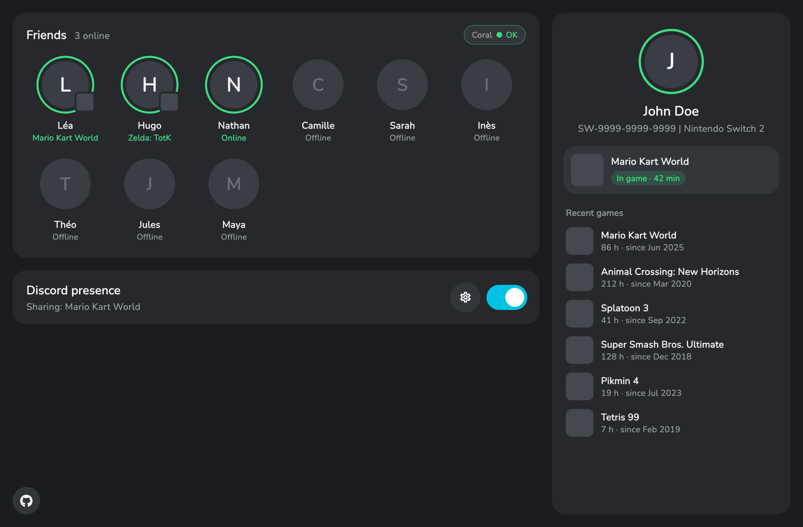
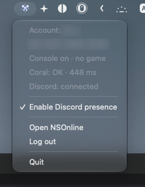
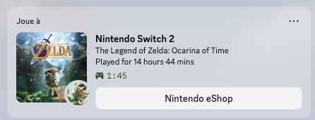
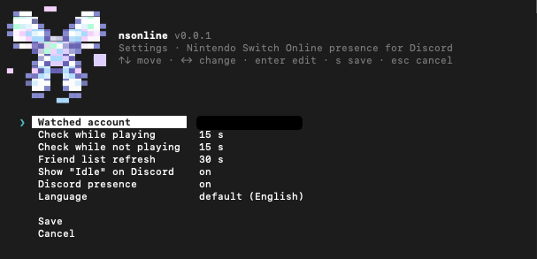

<p align="center"> 

</p>

# NSOnline - Nintendo rich presence for discord

<p align="center">
  
  
  
  
  
  
  
</p>

</br>

<p align="center">
  
  
</p>
<p align="center">

<p/>


## Features

- Mirrors a Nintendo Switch / Switch 2 friend's presence (usually your own account, seen from a second "observer" account) to your Discord status: game, art, play time, your avatar and friend code, "Idle" when the console is on without a game.
- Desktop app for macOS, Windows and Linux, running in the background from the menu bar / system tray.
- Guided setup on first launch, settings with undo, automatic updates from GitHub releases.
- Full CLI (`nsonline setup`, `nsonline config`, `nsonline watch`…) for headless use.
- English and French.

*Please notice that all screenshots use demo data.*


## Installation

Download the latest release from the [releases page](https://github.com/dorydev/NSOnline/releases), then pick your system.

| System | File | Notes |
|---|---|---|
| macOS 12+ | `NSOnline-<version>-macos-universal.dmg` | Open the dmg and drag **NSOnline** into Applications. "Launch at login" needs macOS 13+. |
| Windows 10+ | `NSOnline-<version>-windows-x64-setup.exe` | Per-user install, no admin rights. The installer isn't signed: on the SmartScreen warning, click **More info → Run anyway**. |
| Linux (any distro) | `NSOnline-<version>-linux-x86_64.AppImage` | `chmod +x NSOnline-*.AppImage` then run it. |
| Debian / Ubuntu | `NSOnline-<version>-linux-amd64.deb` | `sudo apt install ./NSOnline-<version>-linux-amd64.deb`, then launch **NSOnline** from your menu. |

Check the download against `SHA256SUMS` from the same release if you want:

```bash
shasum -a 256 -c SHA256SUMS --ignore-missing   # macOS
sha256sum -c SHA256SUMS --ignore-missing       # Linux
```

On Linux the tray icon needs an AppIndicator-capable panel (GNOME needs the *AppIndicator* extension). The `.deb` pulls the runtime libraries (`libgtk-3-0`, `libwebkit2gtk-4.1-0`, `libayatana-appindicator3-1`, `libnotify4`).

### First launch

You need the **Discord desktop app** running, and a **second Nintendo Account** (the *observer*) that is friends with the account you want to show. Coral, the Nintendo Switch Online app API, only returns friends' presence, not your own.

The setup screen walks you through it:

1. Accept the [nxapi-znca-api](https://github.com/samuelthomas2774/nxapi-znca-api) terms (it computes the tokens Coral requires).
2. Log in with the observer account. A Nintendo login window opens.
3. Optionally log in with your main account too: the app then lists your own friends, and game services open with it.
4. Pick the account to show on Discord.
5. Test Discord, and choose to start with your computer.

Closing the window keeps NSOnline running in the menu bar / tray. Use **Quit** from the tray menu to stop it.

### Updates

The app checks GitHub releases every 6 hours and shows a "New version" badge. **Settings → Updates** checks right away and installs: the download is verified with `SHA256SUMS`, then the app restarts on the new version.

### Uninstall

- **macOS**: delete `/Applications/NSOnline.app`.
- **Windows**: *Settings → Apps → NSOnline → Uninstall*.
- **Linux**: delete the AppImage, or `sudo apt remove nsonline`.

Your accounts and settings stay in the data folder; delete it too for a clean removal:

| System | Data folder |
|---|---|
| macOS | `~/Library/Application Support/nsonline` |
| Windows | `%APPDATA%\nsonline` |
| Linux | `~/.local/share/nsonline` |

## Command line

The `nsonline` binary does everything the app does, for servers or if you prefer the terminal. It uses the same data folder as the desktop app, and refuses to change it while the app is running.

```bash
nsonline setup     # guided setup: consent, logins, watched account, Discord test, intervals, language
nsonline config    # change the settings (menu, saved on "s", cancel restores the saved config)
nsonline watch -friend <nsaId|name>   # mirror a friend's presence to Discord
nsonline friends   # list the observer's friends with their nsaId
nsonline --help    # every command and flag
```

Add `--lang fr` (or `NSONLINE_LANG=fr`) for French messages.


**Tray menu :** A short view of `nsonline setup`

<p align="center">

</p>


## Build from sources

### Prerequisites

- `Go 1.22+`
- `Flutter 3.x` (desktop app)
- `make` (Windows: Git Bash/MSYS2 or WSL, or use `packaging/windows/build.ps1`)
- Platform toolchain: Xcode (macOS), Visual Studio 2022 with "Desktop development with C++" (Windows), or `clang cmake ninja-build pkg-config libgtk-3-dev libwebkit2gtk-4.1-dev libayatana-appindicator3-dev libnotify-dev` (Linux)
- Your own Discord applications and an [nxapi-auth](https://nxapi-auth.fancy.org.uk) client (scopes `ca:gf ca:er ca:dr`); see [CONTRIBUTING.md](CONTRIBUTING.md)

### Configure

```bash
cp .env.example .env
chmod 600 .env
# fill in DISCORD_CLIENT_ID_SWITCH2, DISCORD_CLIENT_ID_SWITCH, DISCORD_CLIENT_ID
# and NXAPI_ZNCA_API_CLIENT_ID (+ secret or shared secret)
```

These values are embedded in the binaries at build time (obfuscated, not encrypted), so the built app needs no configuration.

### Build

```bash
make build          # .env → embedded secrets, backend, desktop app for your OS
make test           # Go and Flutter tests
make help           # every target
```

The app lands in `app/build/<os>/…` with the backend (`nsonline-core`) next to its executable. CLI only:

```bash
make secrets
go build -o nsonline ./backend/cmd/nsonline
./nsonline setup
```

On Apple Silicon with a recent Xcode, a universal macOS build can fail on `lipo -verify_arch`. Build for your machine only with `FLUTTER_XCODE_ARCHS=arm64 FLUTTER_XCODE_ONLY_ACTIVE_ARCH=YES make build`.

### Packages

```bash
make package-macos     # signed + notarized .zip and .dmg (NSONLINE_UNSIGNED=1 to skip signing)
make package-windows   # Inno Setup installer (iscc on PATH)
make package-linux     # AppImage + .deb
make checksums         # dist/SHA256SUMS
```

Artifacts go to `dist/`. Release steps are in [scripts/release.sh](scripts/release.sh) and [CONTRIBUTING.md](CONTRIBUTING.md).

## License & credits

Copyright (C) 2026 dorydev

This program is free software: you may redistribute and/or modify it under the terms of the GNU Affero General Public License published by the Free Software Foundation, version 3 of the license or (at your option) any later version (`AGPL-3.0-or-later`, the same license as nxapi). It is distributed without any warranty. See [LICENSE](LICENSE).

The Coral protocol, the `f` stream, and encryption have been documented using [nxapi](https://github.com/samuelthomas2774/nxapi). The `f` stream and encryption are provided by [nxapi-znca-api](https://github.com/samuelthomas2774/nxapi-znca-api), and you must comply with its [terms of use](https://github.com/samuelthomas2774/nxapi-znca-api/blob/docs/docs/public-api-terms.md).

This project is neither affiliated with Nintendo nor endorsed by Nintendo.
